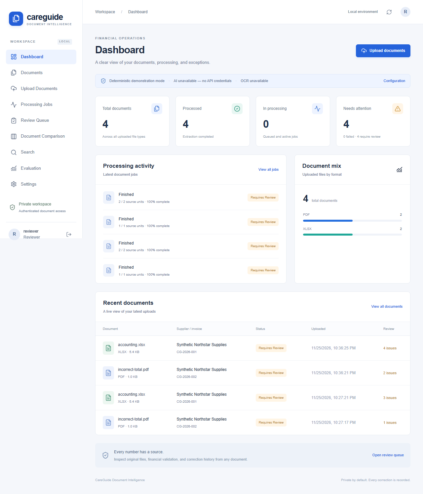

# CareGuide AI Document Intelligence

A working local financial-document workflow: upload private files, process them asynchronously, inspect structured invoices and source evidence, validate arithmetic, compare PDF/PDF and PDF/Excel records, correct values with an audit trail, and search saved records.

Built against the supplied **Ai Engineer Task 1.3.pdf** (seven tasks, nine deliverables). The application is intended for local demonstration; no deployment was performed. All bundled financial records are clearly synthetic.

**Verified:** persistent SQLite + background-process demo, digital PDF/XLSX/XLS/CSV parsing, Decimal validation, comparisons, review/corrections, authenticated API, production Next.js build and real Chromium acceptance workflow. **Not verified here:** real OCR binary, live LLM/embeddings, PostgreSQL/Redis/Celery runtime and 1000-page throughput. Deterministic demo parsing is explicitly labeled and is not AI.



## Quick start — Windows, no paid services

From `D:\Projects\CareGuide-AI-Assessment`, with Python 3.13 and Node 22:

```powershell
python -m venv .venv
.\.venv\Scripts\python -m pip install -r requirements-lock.txt
powershell.exe -NoProfile -ExecutionPolicy Bypass -File scripts/setup-local.ps1 -SkipInstall
npm.cmd ci --prefix apps/web
```

The script creates a private ignored `.env` with random credentials, migrates SQLite, and generates fixtures. Read DEMO_PASSWORD in your editor; username is `reviewer`. It does not print secrets. No venv activation or permanent execution-policy change is required.

Run in separate terminals:

```powershell
# Terminal 1 — API and local background processor
.\.venv\Scripts\python -m uvicorn app.main:app --app-dir services/api --host 127.0.0.1 --port 8000
```

```powershell
# Terminal 2 — frontend
npm.cmd run dev --prefix apps/web
```

Open **http://localhost:3000**. API docs: **http://localhost:8000/docs**. Use localhost consistently for browser/API cookies. A production frontend build can be served with `npm.cmd run build --prefix apps/web`, then `npm.cmd run start --prefix apps/web`.

## Architecture and structure

Next.js App Router/TypeScript/Tailwind frontend → FastAPI/Pydantic API → SQLAlchemy database/private file storage → local process or Redis/Celery → bounded readers → structured extraction → deterministic validation → review/search/comparison. PostgreSQL with pgvector is the target service stack; durable SQLite is the verified single-machine fallback. [Architecture diagram and decisions](docs/architecture.md), [database schema](docs/database-schema.md).

```text
apps/web/                  Next.js routes, reusable page components, Playwright
services/api/app/          API/auth, ORM, readers, extraction, finance, search, jobs
services/api/migrations/   Alembic schema
worker/                   Celery task entry point
scripts/                  local setup, synthetic fixtures, evaluation, password reset
tests/                    processing, finance, API, failure and security tests
sample-data/              synthetic PDFs, images, multi-sheet/legacy workbooks, CSV, truth
docs/                     architecture, API, setup, evidence, disclosure and demo script
docker-compose.yml        PostgreSQL/pgvector, Redis, API and Linux OCR worker
```

## Features and routes

| Frontend | Function |
| --- | --- |
| / | Real database counts, recent documents, processing activity and file distribution |
| /upload | Multi-file selection/drop, size/type checks, upload progress, per-file results |
| /documents | Search, status/format filters, pagination and source links |
| /documents/{id} | Private source preview, extracted/effective fields, evidence, validation, corrections, history |
| /jobs | Live processing stage, progress, retries, cancellation and stale recovery |
| /review | Unapproved exceptions with source-linked document review |
| /comparison | Multi-document baseline comparison, sheet/row/column mapping, differences and saved snapshots |
| /search | Independent keyword retrieval; optional genuine semantic search when configured |
| /evaluation | Saved measured evaluation, methodology and capability limitations |
| /settings | Safe provider/OCR/database configuration status and readiness check |

The API implements uploads, lists/details/status/extraction/validation/source, retries, corrections, jobs, search, comparisons, review and evaluation. See [full route reference](docs/api-reference.md) and generated OpenAPI. Originals remain private; all financial routes require authentication, ownership and appropriate reviewer authorization.

## Environment and services

Copy values deliberately from `.env.example`; do not overwrite the generated local credentials accidentally.

| Variable | Purpose |
| --- | --- |
| DATABASE_URL | SQLite local URL or PostgreSQL psycopg URL |
| EXECUTION_MODE | `local` separate-process fallback or `celery` |
| REDIS_URL | Broker address in Celery mode |
| STORAGE_DIR | Private originals, default ./data/uploads |
| SESSION_SECRET | At least 32 random characters; rotate to invalidate sessions |
| DEMO_USERNAME / DEMO_PASSWORD | Local initial account; password at least 12 characters |
| POSTGRES_PASSWORD | Required by Compose; use a strong URL-safe password |
| EXTRACTION_MODE | `deterministic_demo` or `llm` |
| LLM_API_KEY / LLM_BASE_URL / LLM_MODEL | Private structured-output provider configuration |
| MAX_LLM_CHUNKS | Maximum provider chunks per document, default 100; not a dollar spending cap |
| EMBEDDINGS_ENABLED / EMBEDDING_MODEL / EMBEDDING_DIMENSIONS | Optional real vector indexing; PostgreSQL required |
| TESSERACT_CMD | Optional absolute path to free OCR executable |
| MAX_FILE_MB / MAX_UPLOAD_FILES / MAX_PAGES | Resource limits (defaults 30 / 10 / 1200) |
| OCR_TIMEOUT / JOB_TIMEOUT | Per-OCR and processing budgets (30 / 3600 seconds) |
| CURRENCY_TOLERANCES | Optional JSON currency→decimal-string tolerance overrides |
| NEXT_PUBLIC_API_URL / CORS_ORIGIN | Browser API URL and permitted frontend origin |

For the full target stack, start Docker Desktop, configure POSTGRES_PASSWORD and secrets, then `docker compose up --build -d`; start the frontend separately. Compose includes migrations and Tesseract. For infrastructure-only services and explicit native worker startup, follow [Windows setup](docs/setup-windows.md). Docker engine was unavailable here; that integration must be checked before submission. Missing Docker does not prevent the verified SQLite demo. Semantic search accurately remains disabled without real embeddings and PostgreSQL. No external paid service is required for local deterministic functionality.

## Migrations, tests and evaluation

```powershell
.\.venv\Scripts\python -m alembic upgrade head
.\.venv\Scripts\python -m pytest -q --junitxml=docs/pytest-results.xml
.\.venv\Scripts\python scripts/generate_samples.py
.\.venv\Scripts\python scripts/evaluate.py
npm.cmd run build --prefix apps/web
```

Run the API/frontend, then `npm.cmd run test:e2e --prefix apps/web` after `npx.cmd --prefix apps/web playwright install chromium`. [Testing methodology and exact evidence](docs/testing.md), [actual evaluation report](docs/evaluation-report.md), [machine-readable metrics](docs/evaluation-results.json).

The measured initial evaluation had 8/14 processing successes, 42.86% failures including five unavailable-OCR fixtures and deliberately corrupt PDF. Eight header fields on the eight successful synthetic documents matched ground truth (64/64). This is not overall AI accuracy or performance on arbitrary layouts. Re-run and consult the report for latest measured timing. No large-file benchmark was performed.

## Demonstration and submission

Use invoice.pdf for a valid 220 total, incorrect-total.pdf for a 250→220 audited correction, accounting.xlsx for a 225 total mismatch, duplicate.pdf for exact checksum detection, and corrupted.pdf for a failed-job retry. Image/scanned fixtures require the separately installed free Tesseract binary. [5–8 minute recording script](docs/demo-script.md), [AI prompts and disclosure](docs/ai-assistance-disclosure.md).

Before GitHub submission:

- Review source, run setup from a clean checkout and understand the architecture/financial rules.
- Install OCR, run scan tests/evaluation; start Docker and verify PostgreSQL/Redis/Celery/pgvector. Configure a real LLM/embedding provider if demonstrating AI; record actual provider evaluation separately.
- Read [known limitations](docs/limitations.md) and [security scope](docs/security.md). Do not claim 1000-page performance, production readiness or unmeasured AI accuracy.
- Record the actual narrated walkthrough. Screenshots and automated browser checks do not replace it.
- Check that `.env`, data/, credentials and private records are excluded. Review the initialized local Git repository, commit source/docs/locks/synthetic data, then push only when you choose to authorize it. Repository publication was explicitly authorized by the user after local verification.
- Submit repository URL, setup, diagram/schema, working code/pipelines, tests/results, measured report, walkthrough and accurate AI disclosure within the assessment deadline. Its five-day statement has no supplied start date; this project does not infer a new deadline.

For port/login/OCR/Docker problems, see [Windows troubleshooting](docs/setup-windows.md). This is an assessment implementation with documented operational limits, not a claim of audited production financial processing.
