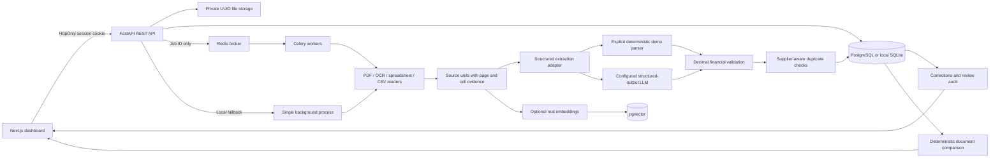

# Architecture

The assessment has seven tasks: ingestion, AI extraction, validation, backend, storage/search, frontend, and evaluation. The local implementation covers a complete deterministic workflow; provider and distributed-service integrations are supplied but require external runtime verification.

## Boundaries and rationale

`services/api/app/main.py` owns HTTP boundaries and ownership checks. `processing.py` reads source files without executing macros. `extraction.py` contains the deterministic adapter, real provider adapter and exact system prompt. `validation.py` performs arithmetic using Decimal; schema monetary values are decimal strings in JSON. `comparison.py` compares structured values and applies optional sheet/row/column mappings. `jobs.py` coordinates persistent state and an atomic SQL claim. `search.py` stores genuine embedding vectors and queries cosine distance through pgvector. `worker/tasks.py` configures Celery.

PostgreSQL is the target deployment database; SQLite/WAL is a persistent, single-machine fallback for environments without Docker. It does not implement semantic search. JSON columns preserve provider snapshots, variable field evidence and complete comparison snapshots; stable identifying fields have ordinary indexed columns. Avoiding separate field and line-item tables keeps this assessment implementation understandable while retaining relational ownership, sources, jobs and audit relationships. See database-schema.md for the tradeoffs.

The browser calls the API directly using an HttpOnly signed session cookie; only the configured frontend origin is allowed. Documents are scoped by owner and reviewer actions require reviewer/admin role. Local credentials are generated randomly into ignored `.env`, never committed. URLs must use `localhost` consistently for browser and API because cookies are host-scoped.

## Background execution

The default local executor runs one separate process so OCR and parsing do not block the request loop. Production-style Compose uses Redis and Celery with two workers, prefetch 1, late acknowledgments, soft/hard task limits, and container memory/CPU limits. Upload persists the document and job before dispatch. Dispatch failure is visible and manually retryable.

A conditional SQL update claims QUEUED jobs. Duplicate deliveries do not re-execute claimed or terminal jobs. A crash after claim leaves a visible stale lease; `POST /api/jobs/recover-stale` marks expired jobs failed, then explicit reprocess creates a new attempt. This avoids infinite redelivery and silent duplicate results. Transient pre-claim connection failures have two Celery retries; processing errors are terminal, with up to three manual reprocess attempts. Corrected values survive reprocessing; raw extraction reflects the latest attempt while audit history retains human changes. Source snapshots from prior extraction attempts are not versioned separately.

Readers release rendered images after each page. Source units and progress are committed incrementally. Cancellation is cooperative at page boundaries and before completion, not immediate interruption of an active provider call. Source text is aggregated after parsing, so text memory grows with file length. Native PDF parsing and the local process do not have Celery's hard kill boundary. No 1000-page load test was run; see limitations.md.

## Extraction and uncertainty

The local parser accepts labeled fixture fields and canonical header rows, not arbitrary invoice layouts. It never claims AI capability. Invalid observed values are retained in evidence and normalized to null with review issues. The provider adapter sends JSON-encoded untrusted text, uses a dedicated system instruction, enables no tools, chunks requests to at most 12,000 characters, validates Pydantic output, handles refusals, and withholds conflicting chunk values. Confidence is uncalibrated and explicitly null; OCR word confidence is a separate source-quality metric. Model evidence uses the chunk location and an excerpt, not verified token-level citations. Complex multi-invoice splitting and reliable merging of differing line-item chunks remain limitations.

## External references consulted

- [Next.js installation](https://nextjs.org/docs/app/getting-started/installation)
- [Structured output API](https://developers.openai.com/api/docs/guides/structured-outputs)
- [Celery task semantics](https://docs.celeryq.dev/en/stable/userguide/tasks.html)

Exact installed backend versions are captured in requirements-lock.txt; frontend versions are locked in package-lock.json. The broad ranges in requirements.txt permit compatible updates but the locks are the reproduction inputs for this verified Windows run.
