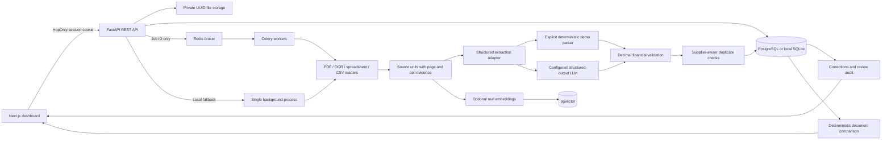

# Architecture

The assessment has seven tasks: ingestion, AI extraction, validation, backend, storage/search, frontend, and evaluation. The local implementation covers a complete deterministic workflow; provider and distributed-service integrations are supplied but require external runtime verification.

## Boundaries and rationale

`services/api/app/main.py` owns HTTP boundaries and ownership checks. `processing.py` reads source files without executing macros. `extraction.py` routes the deterministic and provider modes. `gemini.py` implements Gemini requests, structured-response validation, and source evidence. `validation.py` performs arithmetic using Decimal; schema monetary values are decimal strings in JSON. `comparison.py` compares structured values and applies optional sheet/row/column mappings. `jobs.py` coordinates persistent state and an atomic SQL claim. `search.py` stores genuine embedding vectors and queries cosine distance through pgvector. `worker/tasks.py` configures Celery.

PostgreSQL is the target deployment database; SQLite/WAL is a persistent, single-machine fallback for environments without Docker. It does not implement semantic search. JSON columns preserve provider snapshots, variable field evidence and complete comparison snapshots; stable identifying fields have ordinary indexed columns. Avoiding separate field and line-item tables keeps this assessment implementation understandable while retaining relational ownership, sources, jobs and audit relationships. See database-schema.md for the tradeoffs.

The browser calls the API directly using an HttpOnly signed session cookie; only the configured frontend origin is allowed. Documents are scoped by owner and reviewer actions require reviewer/admin role. Local credentials are generated randomly into ignored `.env`, never committed. URLs must use `localhost` consistently for browser and API because cookies are host-scoped.

## Environment boundaries

`Settings` identifies development, test and evaluation. Development retains the existing `.env`, `data/careguide.db` and `data/uploads` unless deliberately configured otherwise. Test/evaluation runners do not load the development `.env`; explicit database/storage paths, automation kind, canonical run UUID and matching directory ownership marker are mandatory. SQLite paths must resolve inside the matching `data/test-runs/<UUID>` or `data/evaluation/<UUID>`. Development paths, path traversal, hardlinks to the configured development database, missing configuration and mismatched identities are rejected before creating an engine. Test/evaluation PostgreSQL configurations require a separately named database containing environment/run ID; PostgreSQL runtime remains unverified.

Pytest sets its context before importing application settings and removes its run-owned temporary files after database handles close. It reads committed fixture inputs without regenerating them. Playwright's outer runner creates a source-only frontend copy in ignored `apps/web/.test-runs/<UUID>` so the running development frontend's build cache/configuration is not reused. Its API/frontend run on separate loopback ports with separate generated credentials. `reuseExistingServer` is false, the API's environment/run identity is checked before each test, and requests carry matching environment/run headers. A development API rejects tagged test requests. Cooperative shutdown releases workers and frontend handles before deleting only the verified run-owned test directories. Reports are retained privately under `data/verification/playwright/<UUID>`.

Evaluation creates its own migrated database, evaluation owner, processing jobs, source records and copied fixtures. Reports stay in its evaluation run directory. The normal Evaluation page may read the latest metrics JSON; evaluation never inserts development records. Startup hooks create only a configured user, not document fixtures. Workers process existing job IDs and do not create uploads; Celery queue names and Redis prefixes include environment/run identity.

Uploads retain environment, automation kind and run ID in existing audit JSON, so no destructive schema migration was needed. Read-only inventory tooling can classify historical records conservatively. Historical records lacking provenance cannot be safely distinguished from manual uploads by filename or checksum and are not auto-selected. Optional cleanup refuses development deletion, requires selected proven IDs plus run-specific confirmation, checks retained references/active jobs, and quarantines originals with a crash-recovery journal while deleting related rows transactionally. Recovery is explicit; permanent file purging is not automated. See testing.md.

## Background execution

The default local executor runs one separate process so OCR and parsing do not block the request loop. Production-style Compose uses Redis and Celery with two workers, prefetch 1, late acknowledgments, soft/hard task limits, and container memory/CPU limits. Upload persists the document and job before dispatch. Dispatch failure is visible and manually retryable.

The API closes its local executor on shutdown. Restart both API and Celery workers together when adopting environment-scoped broker queues; older default `celery` queues are not consumed by the new namespace. No broker/runtime claim is inferred from local SQLite tests.

A conditional SQL update claims QUEUED jobs. Duplicate deliveries do not re-execute claimed or terminal jobs. A crash after claim leaves a visible stale lease; `POST /api/jobs/recover-stale` marks expired jobs failed, then explicit reprocess creates a new attempt. This avoids infinite redelivery and silent duplicate results. Transient pre-claim connection failures have two Celery retries; processing errors are terminal, with up to three manual reprocess attempts. Corrected values survive reprocessing; raw extraction reflects the latest attempt while audit history retains human changes. Source snapshots from prior extraction attempts are not versioned separately.

Readers release rendered images after each page. Source units and progress are committed incrementally. Cancellation is cooperative at page boundaries and before completion, not immediate interruption of an active provider call. Source text is aggregated after parsing, so text memory grows with file length. Native PDF parsing and the local process do not have Celery's hard kill boundary. No 1000-page load test was run; see limitations.md.

## Extraction and uncertainty

The reader processes one image frame or PDF page at a time. A PDF page enters OCR when its text layer is very sparse, or when a large image covers at least 55% of the page and the text layer contains fewer than 150 characters. That second test covers scanned pages with a digital footer. PDF pages render in grayscale under the pixel budget. Image uploads are checked against their declared format and page and pixel limits. Preprocessing applies EXIF orientation, grayscale, contrast adjustment, median filtering and small-angle deskewing.

The worker probes installed Tesseract language models. It sends the preprocessed image to the native executable over standard input and reads TSV over standard output. It invokes the executable directly with an argument list because the previous Python wrapper passed literal quotes around Windows tessdata paths. Optional orientation detection has a short timeout. Recognition receives the remaining page time budget. Recognition errors fail the current job and preserve the existing retry flow.

OCR source units store page number, recognized text, word boxes in preprocessed-image pixels, language, mean word confidence and elapsed OCR time. The invoice parser uses these units as evidence and preserves missing values. A blank or low-confidence page creates an OCR review warning. Reviewers can correct structured values while inspecting the stored source text. Corrections preserve the original OCR evidence and its warning, and the same Decimal rules check the corrected invoice.

The local parser uses label aliases, aligned PDF words, header-driven tables, text fallbacks and canonical spreadsheet records. Source units preserve original text, blocks and digital-PDF word bounding boxes. Missing and conflicting values remain null and invalid observations produce review issues. See [invoice layout regression](extraction-fix.md).

### Gemini routing and evidence

`deterministic_demo` is the default. `gemini_auto` selects Gemini when local extraction is incomplete, OCR confidence is low, or extraction or Decimal validation reports issues. `gemini` always uses Gemini. The existing `llm` mode continues to use the OpenAI-compatible adapter. All routes feed the same Decimal validation, duplicate detection and correction workflow.

The native backend reads the Gemini key from its ignored local `.env`. The Google Gen AI SDK uses the Gemini Developer API endpoint with redirects and ambient proxy configuration disabled. It sends JSON-encoded document text in chunks of at most 12,000 characters, with a separate system instruction. The request enables no model tools. The adapter validates complete responses against a strict Pydantic model and verifies returned values against the original chunk before local normalization. Missing or unverified fields stay null. Conflicting header values are withheld for review and line items are collected in chunk order with per-field page or sheet evidence.

Evidence records the source location, matched text, extraction method and available OCR confidence. A text match supports the value's presence. Reviewers still need to verify field assignment and line-item associations, particularly when a page repeats amounts. The adapter has no calibrated field probabilities. Layout coordinates, rows spanning chunk boundaries, repeated page rows, tax-inclusive interpretation and multi-invoice splitting remain limitations.

Requests have configurable timeouts and output limits. A transient network failure or select 5xx status can use one retry within the per-document budget. HTTP 429 stops the job with a safe quota message. Provider usage audits contain request counts, available token counts and elapsed seconds. The existing manual job retry remains available.

## External references consulted

- [Next.js installation](https://nextjs.org/docs/app/getting-started/installation)
- [Structured output API](https://developers.openai.com/api/docs/guides/structured-outputs)
- [Gemini structured output](https://ai.google.dev/gemini-api/docs/structured-output)
- [Celery task semantics](https://docs.celeryq.dev/en/stable/userguide/tasks.html)

Exact installed backend versions are captured in requirements-lock.txt; frontend versions are locked in package-lock.json. The broad ranges in requirements.txt permit compatible updates but the locks are the reproduction inputs for this verified Windows run.
