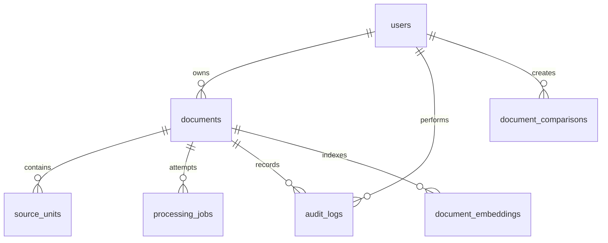

# Database schema

Alembic revision `0001` creates the relational schema and PostgreSQL vector extension. Revision `0002` adds composite indexes and removes the PostgreSQL column's fixed 1,536-dimensional type constraint while retaining existing vectors. SQLite keeps its existing vector column definition and has keyword search. Run migrations against the intended database before starting the API.

The final Windows installation applied both revisions to fresh SQLite. The PostgreSQL service regression verified the upgrade against a disposable database with a pre-existing legacy vector. See [isolation and stack verification](testing.md#postgresql-redis-and-celery-verification).

| Entity | Stored data / relationships |
| --- | --- |
| users | UUID, unique username, salted scrypt hash, reviewer/viewer/admin role |
| documents | Owner FK; original name/type/size/checksum/private path; status/upload time; page/sheet counts, processing duration and safe error; raw invoice JSON, partial corrections JSON, evidence JSON, validation issues JSON, extracted text, review status; indexed normalized lookup columns |
| source_units | Document FK, ordered position and JSON page or worksheet, including text blocks, OCR confidence or typed cell rows/formula cache evidence |
| processing_jobs | Document FK; status, progress, stage, page counters, retry count, created/updated times and safe error |
| audit_logs | Actor FK, optional document FK, timestamp, action and immutable application-level detail snapshots (old/new field values, reason, notes, comparison mappings, provider usage) |
| document_comparisons | Owner FK, ordered document UUIDs, timestamp and complete pairwise baseline result snapshots with source evidence |
| document_embeddings | Document FK, exact source chunk and offsets, page or sheet when known, model identifier, pgvector vector |

Invoice snapshots, line items, field evidence, validation rules, corrections and review decisions are represented by JSON columns/audit entries rather than sixteen individual tables. This is an explicit assessment tradeoff: evidence is durable, arrays remain ordered, Decimal values remain strings, and raw values stay separate from human edits. Per-line analytics or relational integrity within comparison UUID arrays would require additional tables in a larger deployment. Raw invoice number and supplier values are copied to indexed lookup columns from effective structured values; duplicate detection uses normalized supplier/invoice values plus date/amount/currency context and checksum.

Validation subtracts the magnitude of a labeled discount exactly once. Both a positive discount and a signed negative discount represent a reduction. Comparisons use the same discount magnitude and display the original values with their signs. Shipping is added as a signed charge, and a positive credit is subtracted. Negative shipping or credit is retained as a signed adjustment and flagged for review. Tax is added unless the invoice explicitly records tax as inclusive.

Indexes cover document identity, status, ownership, checksum and operational foreign keys. Revision `0002` adds composite indexes for owner and upload time, source document and position, and embedding model and document. The real PostgreSQL regression verifies the indexes and checks an `EXPLAIN` plan using the owner/time index with sequential scans disabled for the small fixture dataset. Keyword search retains parameterized substring matching across document metadata, text and raw/corrected JSON. That substring workload still scans text. Semantic search is exact cosine ordering over visible documents of the requesting owner, filtered to the current model and vector dimension.

SQLite enforces foreign keys and WAL. PostgreSQL migrations require an account authorized to create the vector extension, or an administrator can provision the extension in the target database first. Local FastEmbed vectors use 384 dimensions. Existing OpenAI-compatible vectors retain their configured dimension. Reprocess documents to reindex them after switching models. A downgrade to fixed-width PostgreSQL vectors fails if incompatible vectors exist. The API preserves originals when applying corrections, and exposes no document deletion operation.
