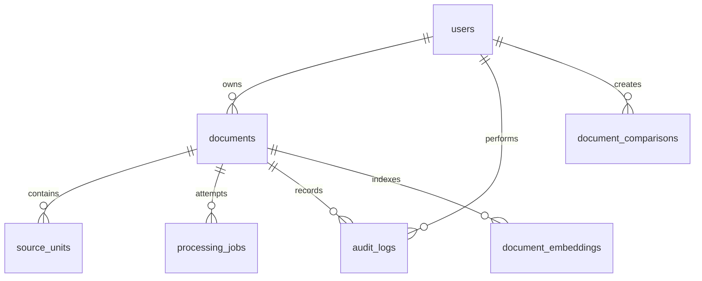

# Database schema

Alembic revision `0001` creates the relational schema and PostgreSQL vector extension. Run migrations before starting the API; application startup does not create tables. The initial migration freezes explicit table and index definitions, independently of future ORM changes. The initial vector dimension is 1536; changing it requires a new migration.

| Entity | Stored data / relationships |
| --- | --- |
| users | UUID, unique username, salted scrypt hash, reviewer/viewer/admin role |
| documents | Owner FK; original name/type/size/checksum/private path; status/upload time; page/sheet counts, processing duration and safe error; raw invoice JSON, partial corrections JSON, evidence JSON, validation issues JSON, extracted text, review status; indexed normalized lookup columns |
| source_units | Document FK, ordered position and JSON page or worksheet, including text blocks, OCR confidence or typed cell rows/formula cache evidence |
| processing_jobs | Document FK; status, progress, stage, page counters, retry count, created/updated times and safe error |
| audit_logs | Actor FK, optional document FK, timestamp, action and immutable application-level detail snapshots (old/new field values, reason, notes, comparison mappings, provider usage) |
| document_comparisons | Owner FK, ordered document UUIDs, timestamp and complete pairwise baseline result snapshots with source evidence |
| document_embeddings | Document FK, source reference JSON, chunk text, model identifier, pgvector vector of configured dimensions |

Invoice snapshots, line items, field evidence, validation rules, corrections and review decisions are represented by JSON columns/audit entries rather than sixteen individual tables. This is an explicit assessment tradeoff: evidence is durable, arrays remain ordered, Decimal values remain strings, and raw values stay separate from human edits. Per-line analytics or relational integrity within comparison UUID arrays would require additional tables in a larger deployment. Raw invoice number and supplier values are copied to indexed lookup columns from effective structured values; duplicate detection uses normalized supplier/invoice values plus date/amount/currency context and checksum.

Indexes cover owner IDs, document status, upload timestamp, invoice number, supplier, checksum, source document IDs, job status/document and audit document. Keyword search uses parameterized case-insensitive matching over those fields, raw/corrected JSON and extracted text; text searches scan and are suitable only for the small assessment dataset. PostgreSQL full-text/trigram indexes and an HNSW vector index are future scaling work. Vector search currently uses exact cosine ordering filtered by owner and embedding model.

No hard-delete API is exposed. Original files are never overwritten by corrections. Application audits are append-only by API convention, not tamper-proof against a database administrator. SQLite enforces foreign keys and WAL; PostgreSQL migrations require an account authorized to create the vector extension. Changing embedding dimensions requires a migration and reindex; do not edit the setting against an existing vector column.
